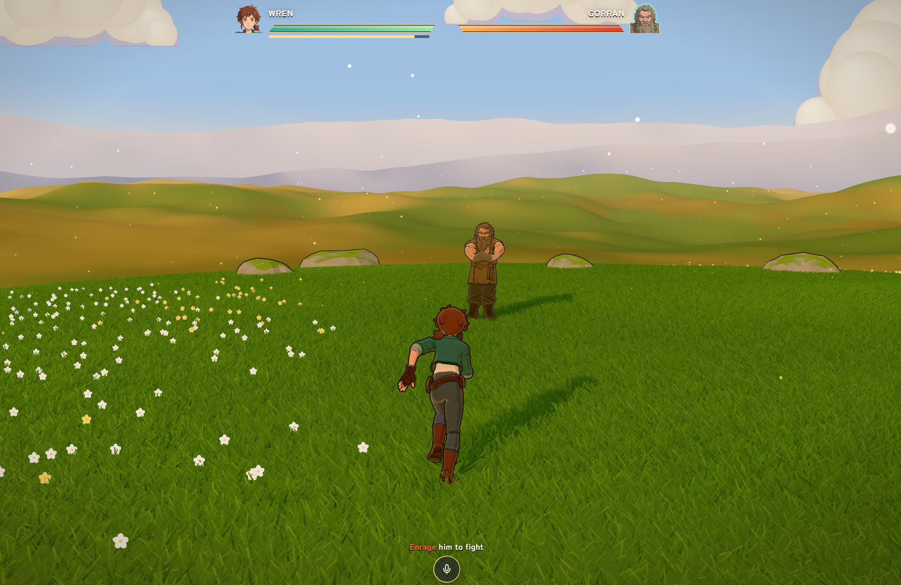

# enrage

A third-person browser fighting game where speech is the core mechanic. The NPC engages
only when provoked and the player recovers only while he is calm, so each round is opened
and closed by what the player says, classified in real time by an LLM judge.

Play it at [enrage.up.railway.app](https://enrage.up.railway.app) (desktop, with a mic).



## The judge

Each transcribed line goes to [`server/judge.ts`](server/judge.ts), which asks Jev, a system
one model, three questions at once:

| Question  | Kind      | Asks                                                        |
| --------- | --------- | ----------------------------------------------------------- |
| `turns`   | yes / no  | Does this line flip his mood?                               |
| `effect`  | 0–4 scale | How far does it move him?                                   |
| `repeats` | yes / no  | Does it just say again what already worked this fight?      |

A mood change requires all three to agree. The cross-check rejects generic insults,
perfunctory apologies, paraphrased repeats and prompt injection aimed at the judge.
The judge is red-teamed against [`evals/cases.json`](evals/cases.json) as a LangSmith
experiment, and each fight's verdicts are traced as one LangSmith thread.

## Stack

| Concern  | Choice                                                              |
| -------- | ------------------------------------------------------------------- |
| Game     | Three.js, TypeScript, Vite; cel-shaded, no engine                   |
| Judge    | Jev via `@langchain/typesafe`, LangSmith for tracing and evals      |
| Speech   | Deepgram streaming speech-to-text, short-lived browser tokens       |
| Voice    | Gorran's lines recorded once with ElevenLabs                        |
| Models   | Tripo-generated characters, Mixamo clips, baked to glTF in a script |
| Server   | Express: keeps API keys off the browser, rate-limited per player    |
| Hosting  | Railway, Telegram alerts for crashes and spend limits               |
| Tests    | Playwright, with the judge stubbed so fights are deterministic      |

## Running

Put the keys in `.env.local`: `DEEPGRAM_API_KEY`, `TYPESAFE_API_KEY`, and
`LANGSMITH_API_KEY` with `LANGSMITH_TRACING=true`.

```bash
npm install
npm run dev     # game and API on http://127.0.0.1:5188
npm test        # Playwright: movement, combat, mood turns, the mic
npm run eval    # run the real judge over evals/cases.json
```

## Controls

| Key        | Does                                 |
| ---------- | ------------------------------------ |
| WASD       | Move; mouse steers                   |
| Left click | Strike                               |
| Shift      | Sprint; tapped alone, dash           |
| Space      | Hold to talk (15 s, then 5 s rest)   |
| R          | Rematch                              |
